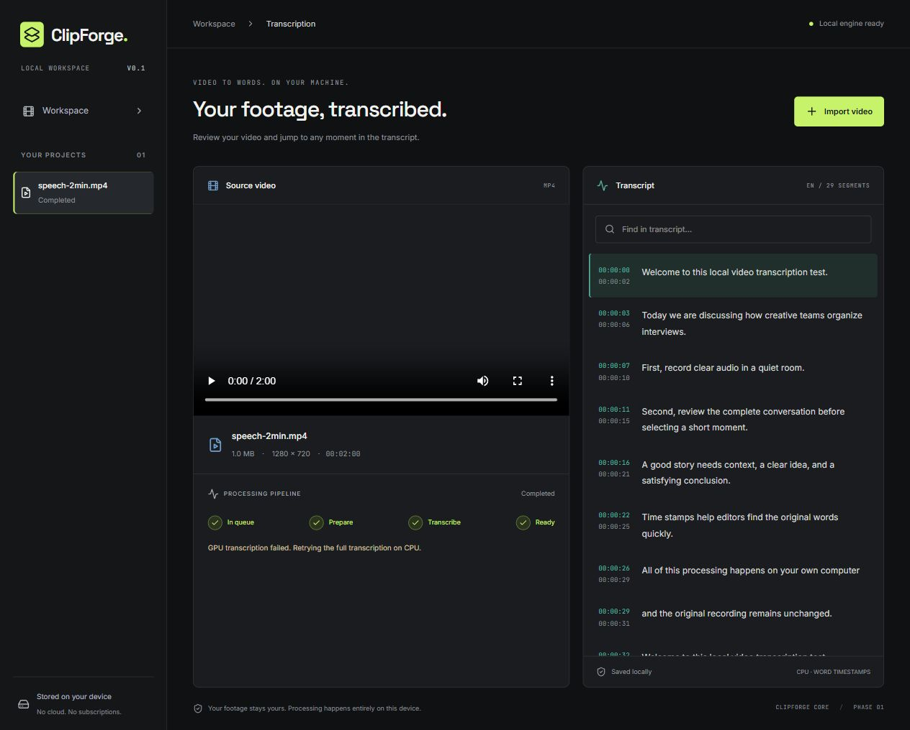

# Tests and acceptance

Current Phase 2 results: [stabilization validation](stabilization.md). The Phase 1 record below is retained as historical evidence.

Automated unit/API checks cover streamed upload validation, path sanitization, source preservation, range playback, completed-result reuse, SQLite restart persistence, interrupted job recovery, useful failures/retry, missing dependencies/models, and CPU fallback for both GPU initialization and lazy inference failures. Engine doubles are confined to tests.

Frontend checks cover type/size validation, disconnected status, reopening a project, transcript search, and timestamp seeking. The TypeScript/Vite production build is a separate check.

## Real-engine check

Prepare a valid two-minute speech MP4 and install a local model, then run:

```powershell
.\.venv\Scripts\python.exe scripts\acceptance.py path\to\speech.mp4 --model models\base --ffmpeg C:\ffmpeg\bin\ffmpeg.exe --ffprobe C:\ffmpeg\bin\ffprobe.exe
```

This opt-in check runs actual FFmpeg/ffprobe and faster-whisper on CPU, validates segment and word timestamps, range playback, completed-project caching, source integrity and restart persistence, then processes a second project with outbound socket connections blocked. It uses temporary project storage and removes it afterward. Model files remain untouched. A socket guard is evidence of network-independent inference, not a physical network-disconnection test.

## Manual acceptance

1. Start both servers and open the local UI.
2. Upload a two-minute MP4 with speech; observe preparing/transcribing/completed stages.
3. Check metadata, playback, segment search and timestamp seeking; compare transcript with speech.
4. Restart both servers, reopen the sidebar project and verify the saved transcript.
5. Physically disconnect networking and import a new speech video with the model installed.
6. On a compatible NVIDIA laptop, verify actual GPU inference and the displayed device; separately force CPU mode.

## Execution record

Verified in the 31 October 2026 development session on Windows, Python 3.11.16, Node 24.18.0, FFmpeg 9.0.2, faster-whisper 1.2.1, and the multilingual `base` model:

| Check | Result |
| --- | --- |
| Backend pytest suite, with FFmpeg executable settings configured | **13 passed** (2.21 seconds) |
| Frontend Vitest suite | **3 passed** |
| TypeScript check and Vite production build | **Passed** |
| npm dependency audit after updating Vitest | **0 vulnerabilities reported** |
| Actual two-minute MP4 → mono WAV → CPU transcription | **Passed**, 29 segments, English detection, word timestamps |
| Two real CPU runs in the final acceptance script | **12.3 seconds / 11.8 seconds** |
| Byte-range playback, source integrity, completed-result cache | **Passed** |
| Recreated application reads persisted SQLite/JSON results | **Passed** |
| Fresh transcription with Python outbound connections blocked and HF offline mode enabled | **Passed** |
| Real corrupt MP4 and video without audio | **Correct actionable errors** |
| Browser import, backend completion, metadata and 29 transcript segments | **Passed** |
| Native browser playback and segment seek | **Passed**; playback advanced, no media error; segment seek reached 16.48 seconds |
| Browser search for “quiet room” | **Passed**, four matching segments |
| Restart both local servers, reload UI and reopen saved project | **Passed**, all 29 segments still available |
| Narrow viewport overflow check | **Passed**, document width equals scroll width (375 CSS pixels) |
| Actual automatic GPU fallback in the browser job | **Passed**, GPU inference failed, warning displayed, CPU completed |

The test MP4 contained 120 seconds of Windows-generated English speech and a solid graphite video frame, encoded as H.264/AAC at 1280×720. It was created locally for validation; no user media was sent to any external service. The opening transcript matched the scripted speech. This is a functional smoke test, not an accuracy benchmark for natural interviews, accents, noise, or overlapping speakers.

The first acceptance run exposed a SQLite connection leak on Windows during temporary-directory cleanup. Connections now close explicitly after every operation; a regression test verifies the database can be removed, and the complete real-engine rerun exited successfully.

The sandbox initially blocked Windows asyncio's internal socket pair before any API code ran. Backend checks and loopback servers were therefore run with approved execution outside that sandbox. No workaround was added to application code.

Successful GPU inference on RTX 4050/5050 hardware and physical network-disconnection testing remain **unverified**. The observed GPU failure did exercise the production CPU fallback. The socket-blocked acceptance test establishes network-independent processing at the Python level without changing the user's system networking.

Two media integration tests skip if FFmpeg/ffprobe cannot be found. To reproduce all 13 checks with the portable build used here, set `CLIPFORGE_FFMPEG` and `CLIPFORGE_FFPROBE` to its binaries before running pytest. The optional `scripts/acceptance.py` check is separate from the 13-test count.


